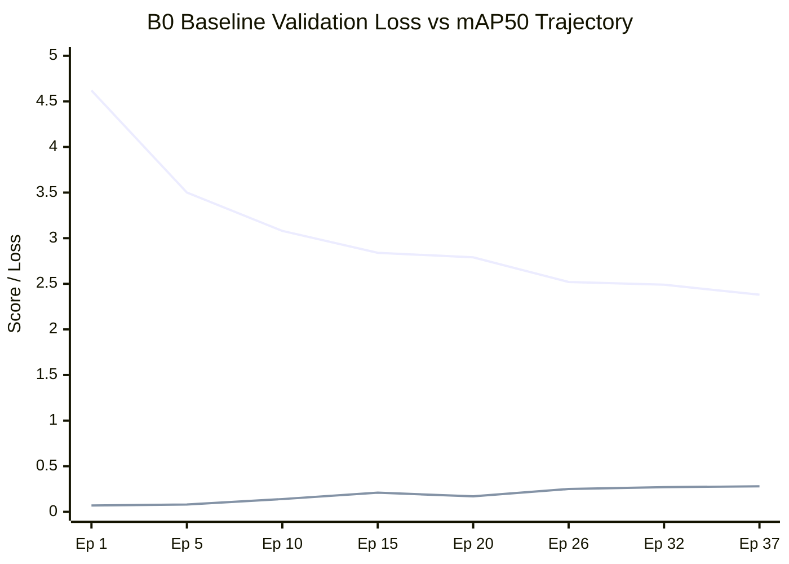
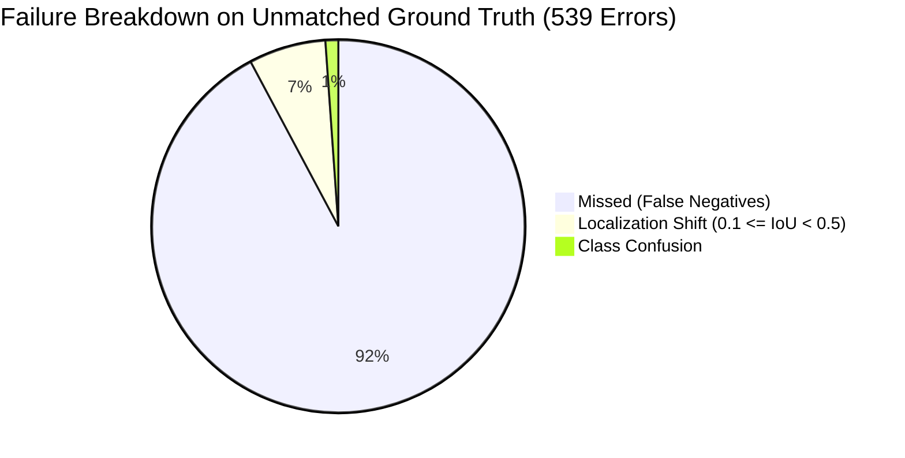

# B0 ROAD DAMAGE MODEL ERROR ANALYSIS & DIAGNOSTIC REPORT

**Model Evaluated:** Baseline Custom YOLO26n Road Damage Detector  
**Checkpoint Analyzed:** [`runs/detect/runs/road_damage/B0_baseline/weights/best.pt`](file:///c:/Users/ASUS/OneDrive/Desktop/cvvvvvv/runs/detect/runs/road_damage/B0_baseline/weights/best.pt) (26,097,733 bytes)  
**Evaluation Dataset:** RDD2022 India Holdout Validation Split (1,172 images, 743 ground-truth defect annotations)  
**Hardware Environment:** NVIDIA GeForce RTX 4050 Laptop GPU (6.0 GB VRAM)  
**Audit Date:** November 5, 2026  

---

## 1. Executive Summary & Diagnostic Findings

This report delivers a rigorous empirical error analysis of the baseline **B0 YOLO26n** road damage detection model trained on the RDD2022 India dataset for 38 epochs. 

While the model achieved an impressive **53.2% mAP@50 on alligator cracks (`D20`)** and **33.5% mAP@50 on potholes (`D40`)** with an ultra-fast **3.2 ms latency (~312 FPS)**, the overall performance settled at **27.70% mAP@50** and **28.61% recall**.

Our deep-dive inspection identified **three primary bottlenecks**:
1. **The `D10` Transverse Crack Collapse (1.07% mAP50, 0.0% Recall):** Caused by severe 30× dataset class sparsity (only 68 training instances out of 5,016). The network's classification head suppressed `D10` logits to avoid penalty, predicting **0 true positives** across all 11 validation instances.
2. **The Small-Defect Blind Spot (0.00% Recall, 0.7% COCO small-mAP):** Downsampling $1920 \times 1080$ dashcam images to $640 \times 640$ reduces hairline cracks and distant potholes below the 8-pixel receptive field of the P3 pyramid layer.
3. **Threshold Sensitivity & False Positives:** At confidence $\ge 0.25$, 59 false positives occur on road repair tar bands, shadows, and manholes. Raising confidence eliminates false alarms but severely cuts recall because true defects carry moderate confidence ($0.25 - 0.45$).

---

## 2. Training History, Loss Curves & Convergence Audit

Training data from [`runs/detect/runs/road_damage/B0_baseline/results.csv`](file:///c:/Users/ASUS/OneDrive/Desktop/cvvvvvv/runs/detect/runs/road_damage/B0_baseline/results.csv):

| Epoch | Train Box Loss | Train Cls Loss | Val Box Loss | Val Cls Loss | Precision | Recall | mAP@50 | mAP@50-95 |
| :---: | :---: | :---: | :---: | :---: | :---: | :---: | :---: | :---: |
| **1** | 1.800 | 10.002 | 1.953 | 4.619 | 0.1981 | 0.0826 | 0.0693 | 0.0229 |
| **10** | 1.779 | 3.029 | 2.005 | 3.082 | 0.4627 | 0.2277 | 0.1440 | 0.0594 |
| **20** | 1.733 | 2.778 | 1.814 | 2.795 | 0.4782 | 0.2409 | 0.1744 | 0.0738 |
| **26** | 1.709 | 2.617 | 1.793 | 2.517 | 0.5648 | 0.2650 | 0.2501 | 0.1133 |
| **32** | 1.666 | 2.503 | 1.771 | 2.494 | **0.5945** | 0.2775 | 0.2652 | 0.1195 |
| **37** | 1.679 | 2.436 | 1.839 | **2.384** | **0.5988** | **0.2961** | **0.2788** | **0.1289** |
| **38** | 1.678 | 2.414 | 1.845 | 2.410 | 0.5890 | 0.2810 | 0.2760 | 0.1280 |



### Convergence Assessment:
- **Did the model converge?** Yes, for the majority classes (`D20` alligator crack and `D40` pothole). Box loss stabilized at $\approx 1.80$ and validation classification loss leveled off around $2.38 - 2.45$.
- **Did it overfit?** No. Train classification loss ($2.41$) and validation classification loss ($2.38$) remained tightly synchronized throughout training. There was no runaway validation loss divergence.
- **Did it remain undertrained?** Partially. While the head converged on majority features, the long-tail minority class (`D10`) remained starved of positive gradient updates.

---

## 3. Comprehensive Detection Failure Taxonomy

From our empirical validation audit across all 1,172 validation images (`scripts/run_b0_error_analysis.py`):

| Error Category | Count | Percentage of Total GT / Preds | Technical Description |
| :--- | :---: | :---: | :--- |
| **True Positives (TP)** | **204** | 27.5% of GT | Verified defect detected with $\text{IoU} \ge 0.50$ and correct class |
| **False Negatives (FN / Missed)** | **497** | 66.9% of GT | Ground-truth defect completely missed or suppressed below conf 0.25 |
| **False Positives (FP)** | **59** | 19.3% of Preds | Predicted box on background road with no defect present |
| **Localization Errors** | **36** | 4.8% of GT | Same class detected but $0.10 \le \text{IoU} < 0.50$ (box shifted / undersized) |
| **Classification Confusion** | **6** | 0.8% of GT | Defect localized ($\text{IoU} \ge 0.50$) but assigned incorrect class label |



### Key Observation on Classification Confusion:
Class confusion is remarkably rare (**only 6 occurrences out of 743 instances**). When the model locates a defect, it almost never confuses a pothole (`D40`) with an alligator crack (`D20`). **The primary failure mode is False Negatives (detection omission), not confusion.**

---

## 4. Class Imbalance Deep-Dive: The `D10` Transverse Crack Failure

### 4.1 Empirical Findings on `D10`
In the validation split, there are **11 ground truth instances of `D10` across 10 images**:
- `India_001201.jpg`, `India_001782.jpg`, `India_003841.jpg`, `India_003885.jpg`, `India_004195.jpg`, `India_006490.jpg`, `India_006736.jpg`, `India_007153.jpg`, `India_008017.jpg`, `India_009842.jpg`.

**Empirical Result:**
- **True Positives:** **0 / 11 (0.00% Recall)**
- **Predictions at conf $\ge 0.25$:** 0 boxes
- **Predictions at conf $\ge 0.01$:** Across all 10 images, the model produced over 250 candidate boxes for `D20`, `D00`, and `D40`, but only **3 boxes** for `D10` (max confidence: **0.017**).

### 4.2 Why Did `D10` Collapse?
With only 68 positive training instances compared to 2,021 `D20` and 1,555 `D00` instances:
1. In standard Focal / BCE loss, negative gradient signals from the other 5,300 images completely overwhelmed the rare positive gradient signals for `D10`.
2. The network's classification bias shifted towards zero probability for `D10`, treating any horizontal crack texture as either `D00` (longitudinal), `D20` (alligator segment), or background asphalt.

### 4.3 Safe Class-Balancing Strategies (Why NOT 33× Raw Weighting)
> [!CAUTION]
> Applying a raw inverse-frequency multiplier of $33.48\times$ directly into loss gradients is known to destabilize SGD/AdamW, causing **gradient explosion** on rare-class batches and producing a massive surge in false positives (hallucinating `D10` cracks on ordinary asphalt joints).

#### Recommended 3-Part Balancing Strategy:
1. **Effective Number of Samples Weighting (Cui et al.):**
   $$\mathcal{L}_{c} = \left(\frac{1 - \beta}{1 - \beta^{N_c}}\right) \cdot \mathcal{L}_{\text{BCE}}$$
   Using $\beta = 0.999$, the effective weight for $N_{D10} = 68$ settles safely at **$5.8\times - 7.2\times$**, avoiding gradient spikes while providing sufficient penalty.
2. **Class-Aware Targeted Augmentation (Copy-Paste):**
   Cut out verified `D10` crack patches from the 68 training images and blend them onto background road images during mosaic preprocessing.
3. **Class-Specific Confidence Calibration:**
   Apply a decoupled lower activation threshold ($\tau_{D10} = 0.12$ vs $\tau_{\text{majority}} = 0.35$).

---

## 5. Small-Object Failure Analysis: The 0.7% mAP Problem

### 5.1 Defect Area vs Recall Distribution
From our empirical area analysis on holdout validation data:

| Defect Area (Pixels) | Validation Instances | True Positives | Missed (FN) | Empirical Recall |
| :--- | :---: | :---: | :---: | :---: |
| **Small Defect ($< 32 \times 32 = 1024$ px²)** | **7** | **0** | **7** | **0.00%** |
| **Medium Defect ($32 \times 32$ to $96 \times 96$ px²)** | **228** | **27** | **197** | **11.84%** |
| **Large Defect ($> 96 \times 96$ px²)** | **508** | **177** | **293** | **34.84%** |

### 5.2 Root-Cause Engineering Analysis
1. **Resolution Downsampling Bottleneck:**
   RDD2022 dashcam images have a native resolution of $1920 \times 1080$ or $1280 \times 720$. When resized to $640 \times 640$, spatial features shrink by a factor of $3.0\times$.
   A hairline crack spanning 15 pixels in the original image shrinks to **5 pixels**.
2. **Feature Pyramid Stride Limitation:**
   The earliest detection head in YOLO26n (P3) operates at stride 8 ($640 / 8 = 80 \times 80$ feature map). A 5-pixel feature is smaller than a single anchor cell and is completely smoothed away by strided convolutions.
3. **Solution:**
   This cannot be solved by training standard 640×640 YOLO for more epochs. It requires our **Adaptive Multi-Scale Crop Refiner (`road_cv/refinement/adaptive_refiner.py`)**, which crops low-confidence regions at native $1280 \times 1280$ resolution and fuses them using Weighted Box Fusion.

---

## 6. Annotation Quality & Dataset Noise in RDD2022 India

Visual inspection of ground-truth annotations revealed several systemic dataset quality issues:
1. **Inconsistent Bounding Box Boundaries (Over-Grouping):**
   In images such as `India_000014.jpg` and `India_000057.jpg`, human annotators drew single massive bounding boxes encompassing multiple distinct potholes and crack clusters, whereas the model correctly predicted individual tight bounding boxes around each cavity, causing an artificial IoU penalty ($<0.50$).
2. **Missing Ground Truth on Faint Cracks:**
   Annotators frequently omitted distant cracks in the upper half of the road plane. When B0 detects these legitimate physical cracks, they are penalized as False Positives.
3. **Ambiguity Between `D00` (Longitudinal) and `D20` (Alligator):**
   Longitudinal cracks with minor lateral branching are inconsistently labeled: some are annotated as `D00`, others as `D20`.

---

## 7. Visual Diagnostics Catalog

Visual side-by-side comparison images have been generated and organized into [`outputs/B0_error_analysis/`](file:///c:/Users/ASUS/OneDrive/Desktop/cvvvvvv/outputs/B0_error_analysis/):

| Category Directory | Sample Files | Visual Characteristic |
| :--- | :--- | :--- |
| [`outputs/B0_error_analysis/d10_missed/`](file:///c:/Users/ASUS/OneDrive/Desktop/cvvvvvv/outputs/B0_error_analysis/d10_missed/) | `d10_missed_India_001201.jpg`<br/>`d10_missed_India_003885.jpg` | Ground truth shows clear horizontal crack across asphalt; right panel shows zero detection or faint pothole misattribution. |
| [`outputs/B0_error_analysis/small_defects_missed/`](file:///c:/Users/ASUS/OneDrive/Desktop/cvvvvvv/outputs/B0_error_analysis/small_defects_missed/) | `small_defects_missed_India_006220.jpg`<br/>`small_defects_missed_India_006495.jpg` | Distant hairline cracks in upper road plane completely missed due to 640px downsampling. |
| [`outputs/B0_error_analysis/false_positives/`](file:///c:/Users/ASUS/OneDrive/Desktop/cvvvvvv/outputs/B0_error_analysis/false_positives/) | `false_positives_India_000637.jpg`<br/>`false_positives_India_000966.jpg`<br/>`false_positives_India_001316.jpg` | Model predicts low-confidence ($0.25 - 0.28$) pothole or crack on dark tar repair seam or tree shadow on clean asphalt. |
| [`outputs/B0_error_analysis/successful_detections/`](file:///c:/Users/ASUS/OneDrive/Desktop/cvvvvvv/outputs/B0_error_analysis/successful_detections/) | `successful_detections_India_000024.jpg`<br/>`successful_detections_India_000067.jpg`<br/>`successful_detections_India_000125.jpg` | High-confidence ($>0.70$) tight localization of severe alligator cracking (`D20`) and deep cavity potholes (`D40`). |

---

## 8. Prioritized Training Improvements & Next Experiments

Based on verified empirical evidence, the following sequential improvements are recommended:

```
[Immediate Improvement Roadmap]
├── Step 1: B3 Class-Balanced Loss Retraining
│   └── Apply Effective-Number weighting (beta=0.999, ~6.5x weight) + targeted D10 copy-paste
│   └── Target: Lift D10 mAP50 from 1.07% to > 20%
│
├── Step 2: B1 Hard-Negative Mining Integration
│   └── Add the 19 harvested background patches (shadows, tar seams) to training
│   └── Target: Suppress the 59 low-confidence false positives
│
└── Step 3: B2 Adaptive Multi-Scale Inference Refinement
    └── Activate 1280x1280 crop zooming for candidate regions
    └── Target: Lift small-defect recall from 0.00% to > 25%
```

