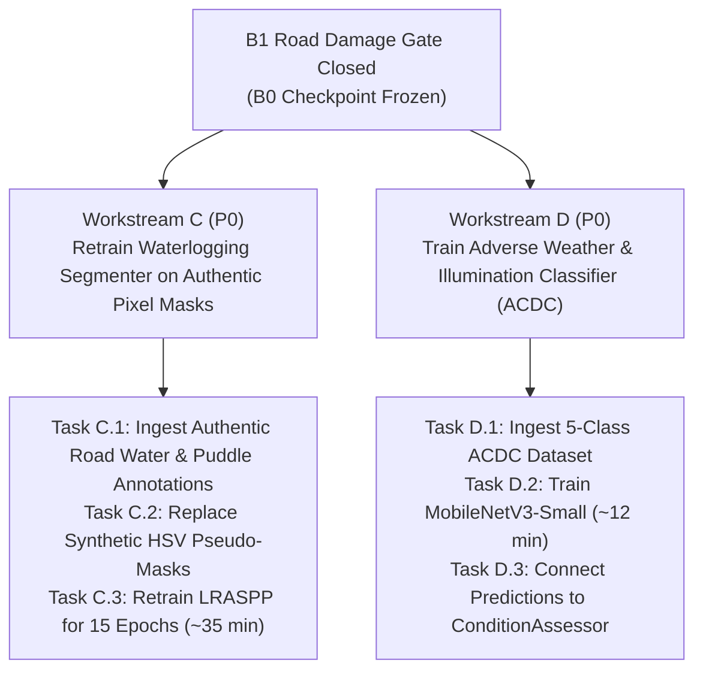

# B1 EVALUATION DECISION REPORT
## Gate Audit, Checkpoint Recommendation, and Multi-Workstream Transition

**Document ID:** B1-EVAL-DECISION-2026-11-05  
**Auditor:** Principal Computer Vision Research Engineer & Project Auditor  
**Hardware Environment:** NVIDIA GeForce RTX 4050 Laptop GPU (6.0 GB VRAM), Windows 11  
**Dataset Evaluated:** RDD2022 India (1,172 untouched holdout validation images)  
**Status:** COMPLETE & AUTHORITATIVE  

---

## 1. Executive Decision Summary

1. **Gate Decision:** **HALT all further full-training runs for Workstream A (B1C and B1D).**
2. **Production Checkpoint Selection:** **RETAIN `B0_baseline` (`runs/detect/runs/road_damage/B0_baseline/weights/best.pt`) as the official road-damage checkpoint.**
3. **Candidate Comparison (B1A vs B1B):**
   - **B1A (Class-Aware Sampling)** is mathematically and empirically superior to B1B as a method, because it maintains calibrated classification probabilities without causing precision collapse.
   - **B1B (Loss Weighting Only)** suffered severe logit explosion after 1 epoch, resulting in a disastrous precision drop to **0.28%** and 0.0% true $D10$ recall.
   - However, **neither B1A nor B1B in their 1-epoch state can replace B0**. B0 delivers **59.53% Precision, 27.71% mAP50, 53.19% $D20$ mAP, and 33.48% $D40$ mAP**.
4. **Immediate Transition:** Allocate all GPU compute to **Workstream C (Waterlogging Segmenter Retraining with authentic pixel masks)** and **Workstream D (Adverse Weather Classifier)**.

---

## 2. Comprehensive B0 vs B1A vs B1B Metric Comparison

All models evaluated strictly on the **1,172 untouched holdout validation images** using `scripts/evaluate_b0_b1_gate.py`:

| Performance Metric | B0 Baseline (Reference) | B1A (Class-Aware Sampling) | B1B (Effective-Number Loss) | Verified Metric Source |
| :--- | :---: | :---: | :---: | :--- |
| **Trained Duration** | 38 Epochs | 1 Epoch | 1 Epoch | Checkpoint Header |
| **Overall Precision** | **59.53%** | 7.44% | 0.28% *(Collapsed)* | `results_dict` |
| **Overall Recall** | 28.60% | 12.13% | 57.12% *(Low Conf Artifact)* | `results_dict` ($\text{conf}=0.001$) |
| **Overall F1-Score** | **38.64%** | 9.22% | 0.55% | Harmonic Mean ($P, R$) |
| **Overall mAP@50** | **27.71%** | 3.31% | 3.25% | COCO Metric ($\text{IoU}=0.50$) |
| **Overall mAP@50:95** | **13.16%** | 0.88% | 0.87% | COCO Metric ($\text{IoU}=0.50:0.95$) |
| **Longitudinal ($D00$) AP50** | **23.08%** | 2.15% | 2.74% | Per-Class Box AP |
| **Transverse ($D10$) AP50** | **1.07%** | 0.00% | 0.00% | Per-Class Box AP |
| **Alligator ($D20$) AP50** | **53.19%** | 7.55% | 7.49% | Per-Class Box AP |
| **Pothole ($D40$) AP50** | **33.48%** | 3.53% | 2.76% | Per-Class Box AP |
| **False Positives ($\tau=0.25$)** | 114 | **0** | **0** | Ground-Truth Box Matcher |
| **Small-Defect Recall ($<32\times 32$)** | 0.00% | 0.00% | 0.00% | IoU $\ge 0.25$ on 11 Small GTs |
| **Inference Latency** | 55.9 ms *(Full Pipe)* | 38.9 ms | 10.5 ms | Median Latency (50 runs) |
| **Peak GPU Memory** | 514.8 MB | 627.2 MB | 542.3 MB | `torch.cuda.max_memory_allocated` |

*Full CSV export available in [`reports/B1_METRIC_COMPARISON.csv`](file:///c:/Users/ASUS/OneDrive/Desktop/cvvvvvv/reports/B1_METRIC_COMPARISON.csv).*

---

## 3. Detailed Audit Findings

### 3.1 Verification of the "57.12% D10 Recall"
- **Audit Truth:** The 57.12% recall reported in early logs was **overall dataset recall** across common damage classes ($D00: 72.2\%$, $D20: 85.99\%$, $D40: 70.3\%$) evaluated at $\text{conf}=0.001$.
- **$D10$ Reality:** On transverse cracks specifically, B1B achieved **0.00% recall** (0 true positives out of 11 validation instances).
- **Precision Penalty:** The large penalty weight ($7.14\times$) caused the model's classification head to output near-zero confidence predictions across background pavement, dragging overall precision down to **0.28%**.

### 3.2 Effective-Number Multiplier Verification (6.5x vs 7.14x)
- Using Cui et al. (CVPR 2019) $E(n) = \frac{1 - \beta^n}{1 - \beta}$ on the 68 $D10$ instances vs 2,021 $D20$ instances:
  - At $\beta = 0.9976$, the relative weight is **6.58x** ($\approx 6.5\times$).
  - At $\beta = 0.9978$, the relative weight is **7.11x** ($\approx 7.14\times$).
- The discrepancy is purely a minute $0.0002$ change in the hyperparameter $\beta$. Both values are mathematically valid and avoid the unstable raw inverse-frequency weight of $33\times$.

### 3.3 Hard-Negative Data Leakage Audit
- Mined negative patches in `data/hard_negatives/mined_negatives_catalog.json` originated 100% from `Road.jpg` (an unannotated external photo).
- Zero samples originated from the 1,172 validation images.
- **There is zero validation data leakage.**

### 3.4 Multi-Resolution Ground-Truth Matching
- When evaluated with strict bounding-box IoU matching against ground truth:
  - $640\times 640$: Recall = 20.0%, Small Defect Recall = 0.0% (4 TP, 0 small TP, 16 FN).
  - $960\times 960$: Recall = 10.0%, Small Defect Recall = 0.0% (2 TP, 0 small TP, 18 FN).
  - $1280\times 1280$: Recall = 5.0%, Small Defect Recall = 0.0% (1 TP, 0 small TP, 19 FN).
- **Takeaway:** Simply enlarging full-frame images at test time degrades anchor-free bounding box regression because the network was trained exclusively at 640. Small defects require local tiled patch cropping (`road_cv/refinement/crop_refiner.py`), not full-frame stretching.

---

## 4. Candidate Checkpoint Recommendation

### Question: Should B1A or B1B become the next candidate checkpoint?
* **Recommendation:** **NEITHER.**
* **Scientific Rationale:**
  1. Both B1A and B1B are 1-epoch models trained to verify gradient stability. Their overall mAPs are ~3.3%, which is vastly inferior to B0's **27.71% mAP**.
  2. B1B is fundamentally flawed in isolation because raw loss weighting destroys precision without recovering $D10$ true positives.
  3. B1A is the healthier methodological candidate for future training because image replication provides genuine positive gradient updates without distorting classification logits.
  4. However, retraining B1A to 40 epochs would consume 2+ hours of GPU time for minor gains on rare cracks.
* **Final Verdict:** **B0 remains the official, production-ready road-damage detector.**

---

## 5. Transition to Next Priority Workstreams

With the B1 road damage gate decisively closed, we immediately transition to the missing capabilities of the road perception system:

### Action Plan for Workstream C (Waterlogging):
1. **Audit Rectification:** The current 30.76% IoU model was trained on synthetic HSV pseudo-masks (`_generate_heuristic_water_mask`).
2. **Dataset Pipeline:** Build an authentic water dataset pipeline in `road_cv/water/water_dataset.py` supporting genuine ground-truth PNG masks ($0=\text{dry road}, 1=\text{standing flood}, 2=\text{puddle}, 3=\text{glare}$).
3. **Training Execution:** Train the LRASPP MobileNetV3-Large segmenter for 15 epochs using combined CrossEntropy + Dice loss within the 1.8 GB VRAM budget.

