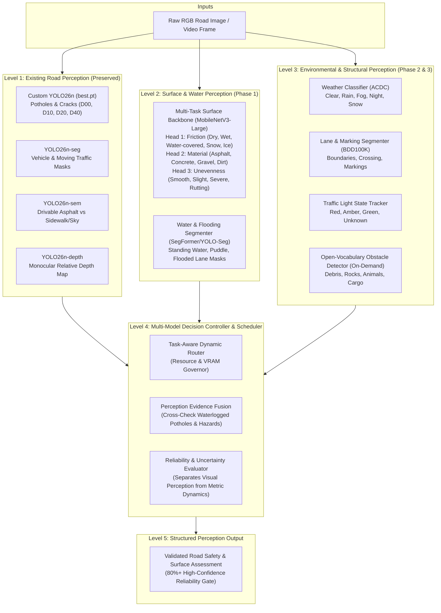

# EXPANSION ARCHITECTURE: MULTI-MODEL ROAD PERCEPTION SYSTEM

## 1. Executive Summary
This architectural document outlines the expansion of the existing Road Intelligence project into an enterprise-grade, multi-task road perception and safety intelligence system. While the baseline system reliably detects localized structural distress (cracks and potholes via custom fine-tuned YOLO26n), this expansion equips the vehicle with comprehensive situational awareness covering:
1. **Surface Friction-Condition Classification** (RSCD)
2. **Road Material Classification** (RSCD)
3. **Road Unevenness & Roughness Classification** (RSCD)
4. **Waterlogging & Flood Segmentation** (R²S100K)
5. **Adverse Weather & Environmental Perception** (ACDC)
6. **Lane & Road-Marking Geometry** (BDD100K)
7. **Open-Vocabulary Road Obstacle Detection** (Grounding DINO / SAM 2)
8. **Traffic Signal State Recognition** (BDD100K)
9. **Video Accident & Collision Event Recognition** (ACCIDENT)

---

## 2. Multi-Model Perception Pipeline & Data Flow

---

## 3. Hardware Constraints & VRAM Scheduling (RTX 4050, 6 GB)
To guarantee strict compliance with the **6.0 GB VRAM limit**:
- **Sequential Pipeline Execution:** Models are loaded and executed sequentially or in small decoupled micro-batches with explicit CUDA cache clearing (`torch.cuda.empty_cache()`, `gc.collect()`).
- **Shared Backbone Efficiency:** Surface friction, road material, and unevenness are unified into a single shared **MobileNetV3-Large Multi-Task Network** (5.48M parameters, ~0.15 GB VRAM).
- **On-Demand Activation:** Heavy modules (such as open-vocabulary obstacle detection or accident video recognition) are triggered conditionally via confidence thresholds rather than running continuously on every frame.

---

## 4. Physical & Scientific Disclaimers
1. **Friction:** Visual classification predicts apparent surface wetness/icing categories (`visual_surface_condition`). It does not compute the physical tyre-road friction coefficient ($\mu$), which requires CAN-bus wheel-slip dynamics.
2. **Roughness:** Visual classification detects surface distress and rutting categories (`visual_unevenness`). It does not compute metric International Roughness Index (IRI), which requires calibrated profilometry or IMU accelerometry.
3. **Pothole Depth:** Monocular depth outputs relative depression ratios. Metric centimeter depths are only asserted after physical calibration against known optical geometry.
4. **Water vs Shadow:** Dark road regions undergo dual-validation against semantic drivable masks and photometric specular reflection analysis to prevent misclassifying tree shadows as water puddles.

