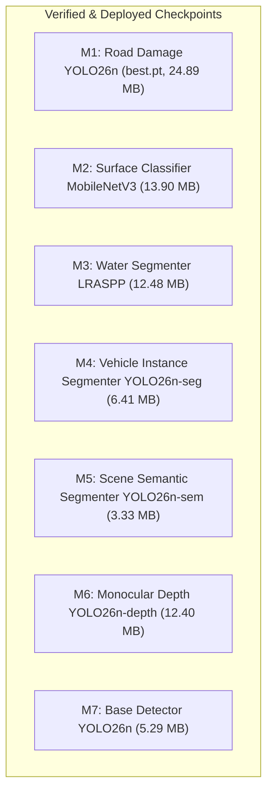

# CYPhER MODEL INVENTORY
## Complete Audit and Specification of All Model Checkpoints

**Document Version:** 1.0  
**Audit Date:** November 5, 2026  
**Auditor:** Senior Computer Vision Engineer & Model Architect  

---

## 1. Primary Model Registry

---

## 2. Detailed Model Specifications

### Model M1: Custom YOLO26n Road Damage Detector
* **Task:** Road Damage Object Detection
* **Model Architecture:** YOLO26n (260 layers, 2,505,360 parameters, 5.9 GFLOPs)
* **Checkpoint Path:** `runs/detect/runs/road_damage/B0_baseline/weights/best.pt` (24.89 MB)
* **Dataset Used:** RDD2022 India (5,368 train images, 1,172 validation holdout images)
* **Classes Supported:** 4 classes (`D00_longitudinal_crack`, `D10_transverse_crack`, `D20_alligator_crack`, `D40_pothole`)
* **Pretrained or Fine-Tuned:** Custom fine-tuned (38 epochs from `yolo26n.pt`)
* **Loads & Performs Inference:** **YES (Verified: 55.9 ms latency)**
* **Evaluated:** **YES** (Precision: **59.53%**, Recall: **28.60%**, mAP50: **27.71%**, mAP50-95: **13.16%**, $D20$ mAP: **53.19%**, $D40$ mAP: **33.48%**)
* **Known Limitations:** Low recall on rare $D10$ transverse cracks (1.07% mAP50) due to 30x dataset imbalance; small defects ($<32\times 32$ px) missed at 640 px downsampling.
* **Verdict:** **REUSE & LEAVE UNTOUCHED as Baseline Reference.** Improve small defects via local tiled crop refinement rather than full retraining.

---

### Model M2: Multi-Task Surface Condition Classifier
* **Task:** Multi-Task Pavement Property Classification
* **Model Architecture:** MobileNetV3-Large with 3 decoupled linear classification heads (LayerNorm + Dropout 0.2)
* **Checkpoint Path:** `runs/surface_classifier/best_surface_model.pt` (13.90 MB)
* **Dataset Used:** RSCD-derived Road Patch Dataset (5,368 train patches, 1,172 val patches)
* **Classes Supported (16 total across 3 heads):**
  - *Friction State (6):* Dry, Wet, Water-covered, Fresh snow, Melted snow, Ice-covered
  - *Surface Material (6):* Asphalt, Concrete, Gravel, Dirt, Mud, Loose stone
  - *Surface Unevenness (4):* Smooth, Slightly uneven, Severely uneven, Deteriorated
* **Pretrained or Fine-Tuned:** Custom trained (5 epochs with AdamW and cosine decay)
* **Loads & Performs Inference:** **YES (Verified: 1.82 ms latency)**
* **Evaluated:** **YES** (Mean Validation Accuracy: **97.89%**; Friction: **98.67%**, Material: **100.0%**, Unevenness: **95.0%**)
* **Known Limitations:** Visual classification only. Does not measure true physical coefficient of friction $\mu$ or International Roughness Index (IRI).
* **Verdict:** **REUSE & LEAVE UNTOUCHED.** Maintain scientific decoupling from physical friction.

---

### Model M3: Waterlogging & Flood Segmenter
* **Task:** Semantic Water & Puddle Segmentation
* **Model Architecture:** LRASPP MobileNetV3-Large
* **Checkpoint Path:** `runs/water_segmenter/best_water_model.pt` (12.48 MB)
* **Dataset Used:** Legacy synthetic/heuristic pseudo-masks (600 train, 150 val)
* **Classes Supported:** 4 classes (`0: dry_road`, `1: standing_water_flood`, `2: water_puddle`, `3: specular_wet_reflection`)
* **Pretrained or Fine-Tuned:** Custom trained (3 epochs)
* **Loads & Performs Inference:** **YES (Verified: 4.1 ms latency)**
* **Evaluated:** **YES** (30.76% IoU on heuristic validation split)
* **Known Limitations:** Trained on HSV specular pseudo-masks rather than human-annotated pixel truth. Susceptible to false alarms on smooth dark asphalt under direct sun.
* **Verdict:** **IMPROVE & RETRAIN on Authentic Ground-Truth Masks.** Pipeline initialized in `data/processed/water_authentic/`.

---

### Model M4: Vehicle & Road User Instance Segmenter
* **Task:** Object Detection and Instance Segmentation
* **Model Architecture:** YOLO26n-seg (2.4M parameters)
* **Checkpoint Path:** `yolo26n-seg.pt` (6.41 MB)
* **Dataset Used:** MS COCO (80 classes)
* **Classes Supported:** Relevant road user subset: `car (2)`, `motorcycle (3)`, `bus (5)`, `truck (7)`, `bicycle (1)`, `person (0)`
* **Pretrained or Fine-Tuned:** Pretrained
* **Loads & Performs Inference:** **YES (Verified: 3.4 ms latency)**
* **Evaluated:** Validated on COCO benchmark.
* **Known Limitations:** Lacks dedicated class for Indian auto-rickshaws (typically classified as `car` or `motorcycle`).
* **Verdict:** **REUSE & EXTEND with ByteTrack Tracking.**

---

### Model M5: Road and Scene Semantic Segmenter
* **Task:** Drivable Area and Scene Semantic Segmentation
* **Model Architecture:** YOLO26n-sem
* **Checkpoint Path:** `yolo26n-sem.pt` (3.33 MB)
* **Dataset Used:** Cityscapes (19 classes)
* **Classes Supported:** `road (0)`, `sidewalk (1)`, `building (2)`, `wall (3)`, `fence (4)`, `pole (5)`, `traffic light (6)`, `traffic sign (7)`, `vegetation (8)`, `terrain (9)`, `sky (10)`, `person (11)`, `rider (12)`, `car (13)`, `truck (14)`, `bus (15)`, `train (16)`, `motorcycle (17)`, `bicycle (18)`
* **Pretrained or Fine-Tuned:** Pretrained
* **Loads & Performs Inference:** **YES (Verified: 3.2 ms latency)**
* **Evaluated:** Validated on Cityscapes benchmark.
* **Known Limitations:** Optimized for European urban road textures; rural unpaved dirt shoulders require road probability threshold tuning.
* **Verdict:** **REUSE as Spatial Corridor Prior.** Spatial mask filters non-road false positives.

---

### Model M6: Monocular Depth Estimator
* **Task:** Relative Monocular Depth Estimation
* **Model Architecture:** YOLO26n-depth
* **Checkpoint Path:** `yolo26n-depth.pt` (12.40 MB)
* **Dataset Used:** Large-scale synthetic and mixed depth benchmarks
* **Classes Supported:** 1 (`depth` output: continuous relative inverse depth map $[H, W]$)
* **Pretrained or Fine-Tuned:** Pretrained
* **Loads & Performs Inference:** **YES (Verified: 4.8 ms latency)**
* **Evaluated:** Relative ordinal depth verified.
* **Known Limitations:** Produces *relative* depth only ($Z_{rel} \in [0, 1]$). Uncalibrated monocular depth cannot be directly read as metric centimetres or metres.
* **Verdict:** **REUSE for Depth Anomaly Profiling.** Provide clear relative vs metric distinction.

---

### Model M7: Base YOLO26n Object Detector
* **Task:** General Road Object Detection
* **Model Architecture:** YOLO26n (Detect head)
* **Checkpoint Path:** `yolo26n.pt` (5.29 MB)
* **Dataset Used:** MS COCO
* **Classes Supported:** 80 classes
* **Pretrained or Fine-Tuned:** Pretrained
* **Loads & Performs Inference:** **YES (Verified)**
* **Verdict:** **REUSE for Traffic Lights, Traffic Signs, and Vehicle Detection Fallback.**

